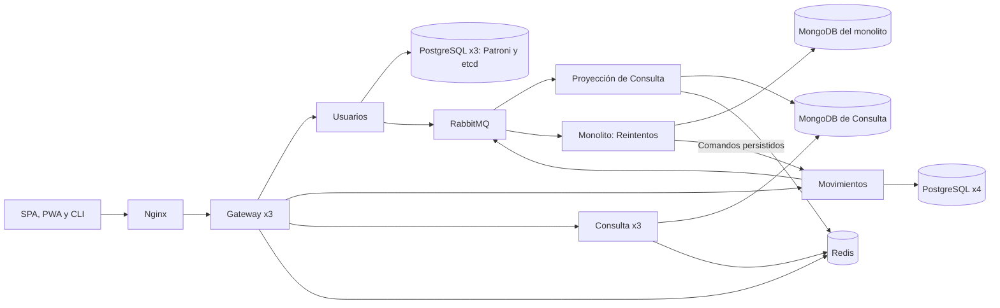

# ACME Paquetería · 04-consulta

Esta es una etapa intermedia de la migración descrita en el [PRD](docs/PRD.md). La versión final y definitiva del proyecto es la rama **`distribuido`**.

Secuencia: `01-monolito` → `02-usuarios` → `03-movimientos` → `04-consulta` → `05-reintentos` → `distribuido`.

## Cambios de esta etapa

Consulta y la actualización de su proyección se extraen del monolito. El gateway balancea el rastreo entre tres instancias de `consulta`; el proceso `proyeccion` consume los eventos y actualiza MongoDB y Redis. El circuit breaker del gateway conserva el respaldo directo en Redis.

Usuarios y Movimientos mantienen la separación de la etapa 03. El proceso `monolito` conserva únicamente Reintentos, sus documentos en MongoDB y sus comandos persistidos hacia Movimientos. No tiene rutas públicas ni abre una API. Todavía no existe un proceso independiente llamado `reintentos`.

## Arquitectura



| Dueño | Datos | Persistencia |
|---|---|---|
| Usuarios | Cuentas, sesiones y revocaciones | PostgreSQL x3 con Patroni/etcd |
| Movimientos | Paquetes, historial, confirmaciones y outbox | PostgreSQL x4 por hash de guía |
| Consulta | Proyección y caché | MongoDB propio y Redis |
| Monolito | Intentos y programación | MongoDB del monolito |

Solo Nginx publica un puerto. RabbitMQ transporta eventos durables; Movimientos guarda el cambio y su evento en una transacción, y los consumidores procesan las reentregas de forma idempotente. Reintentos programa franjas alternadas durante tres días de visita, escala a sucursal y permite registrar la decisión del proveedor. Una entrega a una revisión anterior de dirección puede requerir recuperación.

## Ejecución

Desde `proyecto`, con Docker Desktop en modo Linux y Compose v2:

```sh
docker compose up -d --build
docker compose ps
```

Abre http://localhost:8084. El proyecto Compose, sus imágenes de aplicación y sus volúmenes tienen nombres propios de esta etapa para poder conservar la instalación definitiva. Si defines `PORT`, ajusta también `ACME_URL` al ejecutar la CLI y las pruebas.

Las cuentas de demostración son `cliente@acme.test`, `repartidor@acme.test`, `proveedor@acme.test`, `almacenista@acme.test` y `administrador@acme.test`. Su contraseña inicial es `AcmeDemo2026!`, o `DEMO_PASSWORD` si se configura antes de crearlas. El primer login espera a que Usuarios disponga de líder y réplica síncrona.

La PWA permite guardar escaneos en IndexedDB, recargar sin conexión y sincronizar un lote al reconectar. Usa un PIN local de cuatro dígitos cada diez minutos. La hora operativa se calcula con un ancla firmada del servidor y tiempo monótono; tras reiniciar offline se conserva el intervalo medido y se marca la incertidumbre. La vista pública oculta los datos personales y el detalle y la corrección de dirección requieren al titular.

## Verificación

Con Node.js 24:

```sh
npm ci
npm test
npm run build:web
npm run test:integration
npm run test:integration -- --fallas
npx playwright install chromium
npm run test:pwa
```

La integración crea un cliente y guías de prueba. `--fallas` detiene y restaura contenedores de esta etapa para comprobar quórum, confirmaciones pendientes, aislamiento del shard, outbox y respaldo en Redis. La prueba PWA también crea guías; `ACME_CHROMIUM_PATH` permite usar un Chromium ya instalado.

La CLI usa el puerto de esta etapa de forma predeterminada. Ejecuta `node distribuido/acme.mjs ayuda` para ver sus operaciones. Define `ACME_CORREO` y `ACME_CONTRASENA`, o proporciona `ACME_TOKEN`. Para crear un envío se necesitan una guía nueva y el UUID de un cliente existente.

Cada etapa se demuestra con sus propios datos. Estas ramas reconstruyen la separación del código; no realizan una migración de los volúmenes de otra etapa. Para apagar conservando sus datos, usa `docker compose down`.

## Siguiente etapa

En `05-reintentos`, el último módulo del monolito se extrae al servicio `reintentos`. Esa rama contiene el mismo código que `distribuido`, la versión final y definitiva.
