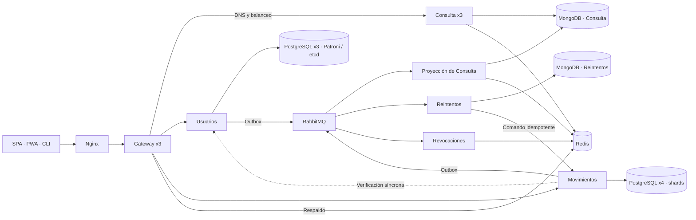

# ACME Paquetería · sistema distribuido

Rastreo y entrega de paquetes con registro de movimientos sin conexión, reintentos de entrega y consulta por guía. El equipo ACME está integrado por @onofrela, @Ur182, @grecia-i y @brannvic. [PRD](docs/PRD.md)

Desde la carpeta que contiene `package.json`, con Docker Desktop en modo Linux y Docker Compose v2:

```sh
docker compose up -d --build
docker compose ps
```

Abre [http://localhost:8080](http://localhost:8080). Si el puerto está ocupado, define `PORT` antes de levantar. El primer login espera a que Patroni elija el líder, arranque al menos una réplica síncrona y se creen las cuentas de demostración.

## Datos de ejemplo para probar la web

Las cuentas de demostración se crean al arrancar. Todas usan la contraseña local `AcmeDemo2026!` o el valor configurado en `DEMO_PASSWORD` cuando se crean.

| Correo | Qué puedes probar |
|---|---|
| `cliente@acme.test` | Ver el detalle privado de las guías de ejemplo y corregir la dirección antes de la salida a ruta. |
| `repartidor@acme.test` | Abrir **Reparto**, elegir un PIN local de cuatro dígitos y registrar movimientos desde la PWA. |
| `proveedor@acme.test` | Crear un envío mediante la CLI. |
| `almacenista@acme.test` | Registrar el paso por almacén y centro de distribución mediante la CLI. |
| `administrador@acme.test` | Registrar contacto, decisión del proveedor o recuperación mediante la CLI. |

En la instancia de demostración actual, pega una de estas guías en [Rastreo de paquetes](http://localhost:8080) y pulsa **Rastrear**. Para ver la dirección y el historial privado, entra como cliente y pulsa **Ver detalle**.

| Guía | Qué muestra |
|---|---|
| `ACME-DEMO-RUTA` | Paquete en centro de distribución. Puedes corregir la dirección como cliente y después iniciar la ruta como repartidor. |
| `PWA-0CC975B9-6E0` | Paquete entregado desde la PWA. El detalle muestra quién lo recibió. |
| `ACME-AF1998D8` | Paquete con intento fallido. El detalle muestra el próximo intento. |

### Crear una guía en una instalación nueva

Las guías de la tabla se guardan en los volúmenes de la instancia. Para preparar un paquete listo para reparto con volúmenes nuevos, ejecuta esto en PowerShell desde **proyecto**, con Node.js 24 y el sistema levantado. Si la guía ya existe, elige otro número. Si configuraste otro puerto, ajusta `ACME_URL` al inicio del bloque.

```powershell
$guia = 'ACME-DEMO-RUTA'
$env:ACME_URL = 'http://localhost:8080'
$env:ACME_CONTRASENA = 'AcmeDemo2026!'
$env:ACME_CORREO = 'cliente@acme.test'
$cliente = (node distribuido/acme.mjs login | ConvertFrom-Json).usuario.id
$env:ACME_CORREO = 'proveedor@acme.test'
node distribuido/acme.mjs envio $guia $cliente 'Cliente de prueba' 'Calle Ejemplo 42, Ciudad de México'
$env:ACME_CORREO = 'almacenista@acme.test'
node distribuido/acme.mjs almacen $guia 'Almacén Demo'
node distribuido/acme.mjs centro $guia 'Centro Demo'
```

Busca la guía unos segundos después para dar tiempo a que se actualice el rastreo. Para probar la entrega desde la web, entra como repartidor, consulta la dirección y guarda **Salida a ruta**. Luego guarda **Entregado** e indica quién recibió el paquete.

## Uso y verificación

- La página principal consulta por guía. El cliente autenticado puede ver el detalle y corregir la dirección antes de la primera salida a ruta.
- El proveedor confirma el envío desde la CLI. El almacenista usa la misma CLI para registrar el ingreso a almacén y luego a centro. El administrador registra contacto, decisión y recuperación de entrega errónea.
- El repartidor abre la vista Reparto, configura el PIN, consulta la dirección vigente y registra la salida a ruta y el resultado. Se puede instalar la PWA en un navegador compatible tras abrirla una vez con conexión. Usa `localhost` o HTTPS para disponer de service workers.
- Si usas otro puerto, define `ACME_URL` antes de la CLI y de las pruebas. La CLI y las pruebas requieren Node.js 24.

```sh
node distribuido/acme.mjs ayuda
npm run test:integration
npm run test:integration -- --fallas
```

La verificación normal crea guías y un cliente desechables. `--fallas` detiene y restaura contenedores de este Compose para comprobar promoción del líder, pérdida de mayoría, aislamiento del shard, recuperación del outbox y respaldo en Redis. También comprueba que un fallo posterior no invalide una entrega pendiente y que las API reconstruyan sus revocaciones tras reiniciar sin Redis. Ejecútalo en una instancia de demostración. Para apagar conservando los datos, usa `docker compose down`.

Las reglas y la compilación se verifican con `npm test` y `npm run build:web`, después de instalar dependencias con `npm ci`. Para probar la PWA en Chromium real, con el sistema levantado:

```sh
npx playwright install chromium
npm run test:pwa
```

La prueba del navegador crea dos guías nuevas. Comprueba la recarga offline, el PIN, la dirección local, la persistencia de la cola y del reloj, la entrega en lote al reconectar y la pérdida de respuestas: tres reintentos con jitter, espera de cambio de red e idempotencia. Se puede definir `ACME_CHROMIUM_PATH` para usar un ejecutable Chromium ya instalado. El service worker actualiza el HTML y sus bundles juntos para conservar la versión visitada al volver a abrir sin red.

Para enviar peticiones al gateway de forma interactiva, importa las [colecciones de Postman](postman/README.md).

## Arquitectura



Nginx publica el único puerto y vuelve a resolver las réplicas del gateway mediante DNS de Compose. Cada gateway rota entre IP de Consulta y prueba otra réplica cuando una falla. El circuito mantiene las últimas 100 solicitudes por réplica, abre un minuto con al menos 50 fallas y prueba 5 % del tráfico al quedar semiabierto. Redis devuelve la vista disponible con un aviso de atraso. Las operaciones de detalle conservan la validación del token y del titular, también al usar el respaldo.

Usuarios guarda cuentas y sesiones en tres PostgreSQL con replicación síncrona y Patroni en modo quórum. etcd, también de tres miembros, arbitra la elección del líder. El servicio consulta el líder, comprueba que tenga al menos una réplica síncrona y espera aplicación remota al confirmar escrituras. Login y registro devuelven 503 mientras falte mayoría. Los JWT de 12 horas se verifican localmente. Los eventos de logout y cambio de contraseña alimentan las listas locales y Redis. Antes de abrir su puerto, gateway, Consulta y Movimientos se suscriben a esos eventos y reconstruyen las revocaciones vigentes desde Usuarios; repiten la recuperación al reconectar con RabbitMQ. Un proceso recién iniciado espera a disponer de esa información. Los procesos ya preparados conservan su lista local y pueden validar tokens aunque caiga Redis o Usuarios.

Movimientos también comprueba la sesión en Usuarios antes de una entrega o corrección. Si la respuesta no llega, guarda el evento pendiente y lo reconcilia posteriormente. Una entrega pendiente hace esperar los movimientos posteriores de esa guía: cuando se confirma, un fallo posterior no puede quitarle el estado terminal. Una corrección pendiente permite registrar salidas y fallos; al confirmarla se actualiza la programación con la nueva dirección.

Movimientos calcula SHA-256 sobre la guía inmutable y usa el primer byte módulo cuatro. Cada partición tiene su propio PostgreSQL y volumen. El UUID es idempotente dentro de la partición a la que pertenece la guía. Se publica el outbox con confirmaciones de RabbitMQ. Las colas durables tienen confirmación manual, consumidor activo único y cola de fallidos. La versión por guía permite ignorar reentregas. Consulta guarda en MongoDB y proyecta a Redis con versiones y reparación si el caché estuvo caído. Reintentos guarda su plan y el comando para Movimientos en la misma actualización atómica de MongoDB.

## Decisiones de la sección 10 del PRD

| Pregunta | Decisión |
|---|---|
| Ruteo y réplica | Movimientos calcula el shard. Cada shard tiene un nodo y conserva su volumen. Un shard caído deja pendientes las escrituras para sus guías. |
| Regiones de Usuarios | Tres regiones simuladas. Se requiere el líder y al menos una réplica síncrona. |
| Franjas | Un intento por día de visita. Los reintentos alternan entre 09:00–13:00 y 14:00–18:00 en Ciudad de México. El tercer día con intento fallido escala a sucursal. |
| PIN | Cuatro dígitos al abrir Reparto y cada 10 minutos de uso desbloqueado. |
| Cronómetro | El ancla firmada y el intervalo monótono medido se guardan por usuario cada segundo, al ocultar/cerrar la página y al escanear. Tras recargar offline se continúa desde ese intervalo y se marca la hora como sospechosa. El tiempo que el navegador estuvo cerrado es desconocido: se conserva una cota temporal, sin calcularla con el reloj del celular ni inventar una duración exacta. Los escaneos ya guardados en IndexedDB conservan sus tiempos originales. Sin ningún ancla previa se usa la recepción del servidor y se marca como sospechoso. |
| Administración | La CLI registra el contacto y la decisión del proveedor. |
| Entrega errónea | Una entrega a una revisión anterior se registra como errónea si la corrección precede a la entrega. El almacenista o administrador registra `recuperado` y el paquete vuelve al centro de distribución para salir de nuevo. |
| Reloj sospechoso | Con más de dos minutos de diferencia, el movimiento conserva la marca en el historial de detalle para revisión operativa. |

## Contrato de entrada

| Ruta bajo `/api/v1` | Operación |
|---|---|
| `POST /auth/registro`, `/auth/login`, `/auth/logout`, `/auth/contrasena` | Registro, sesión y revocación |
| `POST /movimientos/envios` | Alta por el proveedor con titular existente |
| `POST /movimientos/escanear`, `/movimientos/sincronizar` | Escaneo único y lote con resultado por UUID |
| `GET /movimientos/hora` | Ancla de tiempo firmada |
| `GET /movimientos/:guia/direccion` | Dirección, revisión y plan vigentes para operación |
| `POST /movimientos/:guia/direccion` | Corrección por el titular con UUID |
| `POST /movimientos/:guia/caso`, `/movimientos/:guia/recuperar` | Escalamiento y recuperación |
| `GET /tracking/:guia`, `/tracking/:guia/detalle` | Rastreo público y detalle privado |

El Nginx, el broker, cada shard y cada base de lectura viven en una sola máquina. Docker Desktop y esos componentes sin réplicas conservan su dominio de falla local. Los volúmenes se conservan al volver a levantar esta configuración. Carga una guía nueva o usa el script de verificación para la demostración.

El diseño aplica redes, volúmenes y Compose de S02–S05, elección y quórum de S06, entrada y balanceo de S07, saga y circuito de S08, outbox y mensajería idempotente de S09, relojes de S10 y persistencia políglota y caché de S11. El despliegue pedido usa Compose y conserva la arquitectura del PRD.
