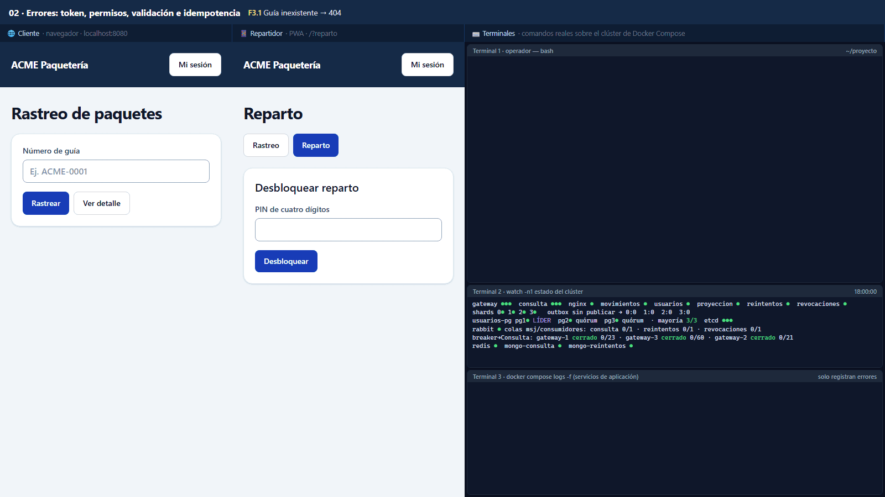
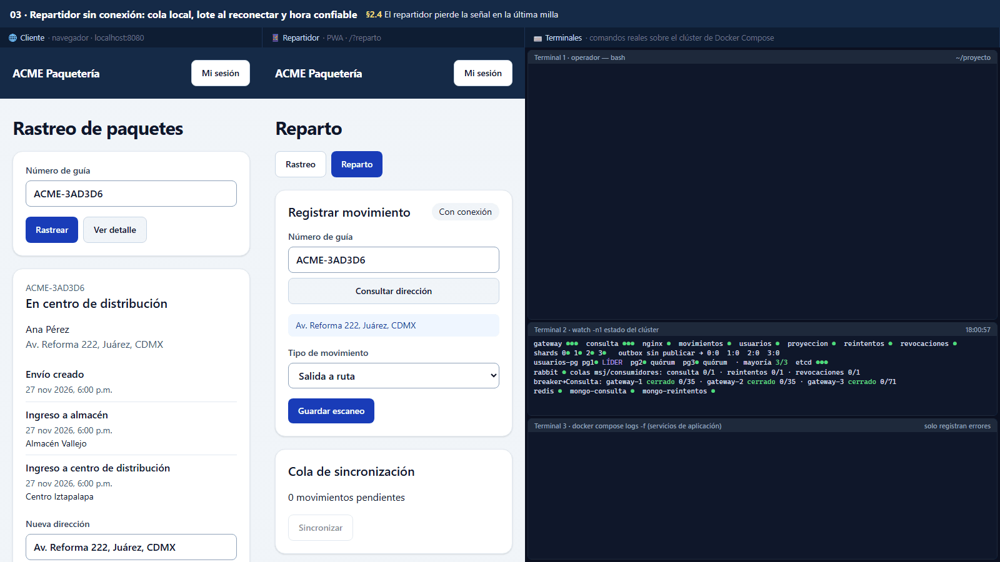
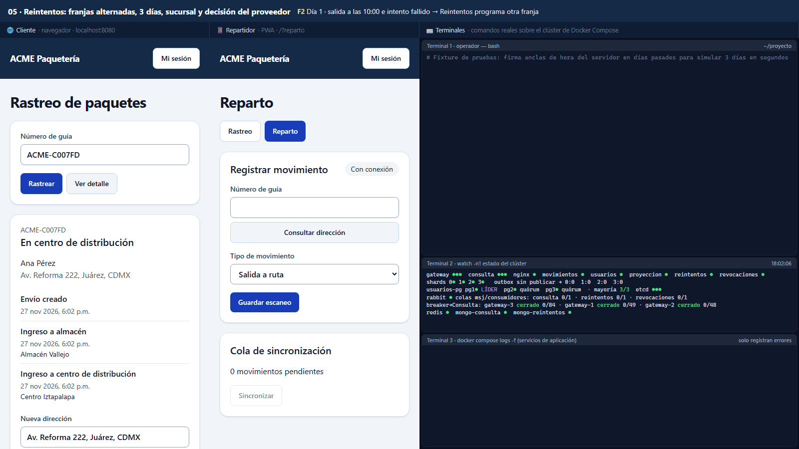
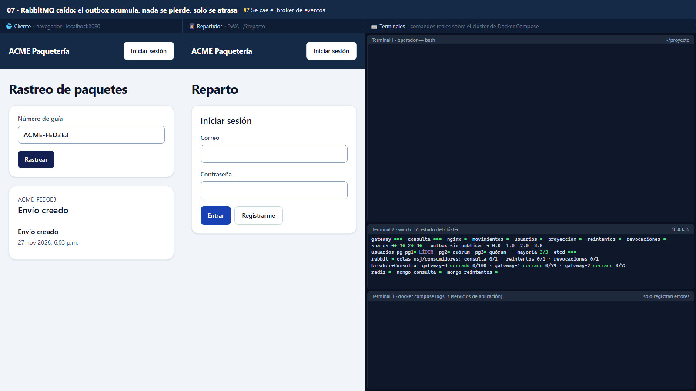
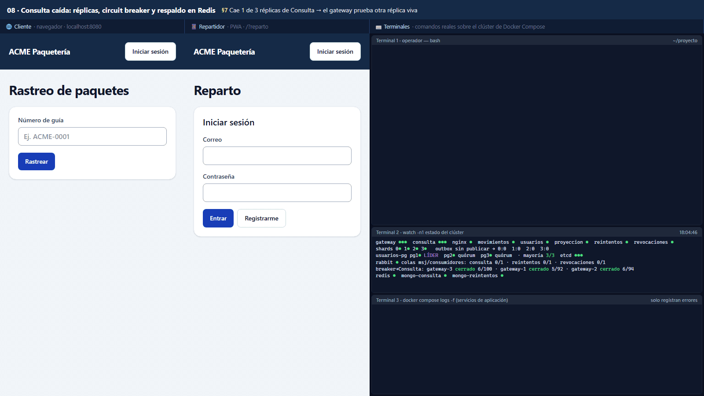
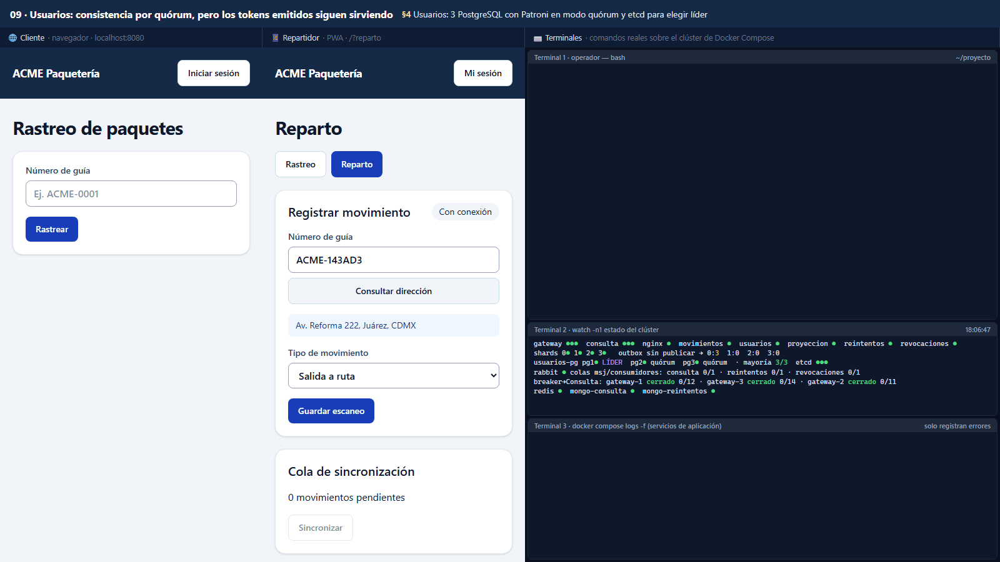

# Pruebas reales en GIF · ¿se alcanzan las ventajas del sistema distribuido?

Diez escenarios grabados contra el clúster real de `docker compose` (26 contenedores). Cada GIF muestra, de izquierda a derecha:

- **Cliente**: el navegador en `localhost:8080`.
- **Repartidor**: la PWA en otro contexto de navegador, con su propia red, almacenamiento y service worker.
- **Terminal 1** con los comandos reales del operador (CLI `acme`, `curl`, `docker compose`). **Terminal 2** con un `watch` del clúster: contenedores, rol de cada nodo Patroni, mayoría, colas de RabbitMQ, outbox sin publicar por shard y estado del circuit breaker de cada gateway. **Terminal 3** con `docker compose logs -f`.

La barra superior indica el criterio del PRD que se prueba. Cada ✓ o ✗ verde o rojo es una verificación automática sobre la respuesta real. El símbolo ⏩ ×N marca tramos acelerados, como la elección de líder, el minuto del breaker o la reconexión del broker.

## Veredicto

| Ventaja que persigue el PRD (§2, §4) | ¿Se alcanza? | Evidencia |
|---|---|---|
| **Aislar fallas**: si cae un shard, solo se afecta ~25 % de las guías | **Sí** | [06](#06--cae-un-shard). La guía del shard caído responde 503 y su escaneo espera en la cola de la PWA. Las guías de otros shards se escriben sin problema y la lectura del cliente no se interrumpe. Al volver el shard, el UUID pendiente entra sin duplicarse. |
| **Repartir escrituras** por hash de la guía | **Sí, en reparto**. No se midió rendimiento | [01](#01--happy-path), [06](#06--cae-un-shard). `sha256(guía)[0] % 4` decide el shard y cada uno tiene su PostgreSQL y su outbox. No se hizo prueba de carga de escrituras. |
| **Picos de lectura**: réplicas, caché y breaker | **Sí** | [08](#08--consulta-caída-réplicas-breaker-y-redis). Una réplica de Consulta caída no se nota. Con las 3 caídas, 360 lecturas concurrentes reciben 200 desde Redis, el breaker se abre en los 3 gateways y se cierra solo con el 5 % de prueba. |
| **Disponibilidad en la última milla** | **Sí** | [03](#03--repartidor-sin-conexión), [04](#04--respuesta-perdida), [09](#09--quórum-en-usuarios), [10](#10--réplicas-del-gateway). La PWA recarga, registra y encola sin red, y envía el lote al reconectar. Ante una respuesta perdida reintenta a 2, 4 y 8 s sin duplicar. Su token sigue sirviendo sin quórum en Usuarios. |
| **Consistencia en Usuarios** (excepción del §4) | **Sí** | [09](#09--quórum-en-usuarios). Al caer el líder, Patroni promueve otro y el login nunca falla. Sin mayoría, login y registro devuelven 503. Un "entregado" que no se puede verificar queda *pendiente*, no terminal, y se confirma al volver la mayoría. |
| **Eventos con outbox**: nada se pierde, solo se atrasa | **Sí, con un límite** | [07](#07--rabbitmq-caído). Las escrituras se aceptan, el outbox acumula y al volver el broker se publica todo. Mientras el broker está caído, Consulta no sirve lecturas y el respaldo es Redis (ver hallazgo 1). |
| **Reintentos e idempotencia** | **Sí** | [05](#05--reintentos). Las franjas alternan, el tercer día pasa a sucursal y el caso se cierra con la decisión del proveedor. Un evento **reentregado de verdad por RabbitMQ** no crea un segundo reintento. |

Resultado de la corrida final: **63 de 63 verificaciones pasaron** en los 10 escenarios ([resultados.json](resultados.json)). Los hallazgos siguientes son matices del diseño que conviene conocer. Ninguno rompe un criterio del PRD.

## Hallazgos

1. **Con RabbitMQ caído, Consulta deja de responder aunque MongoDB esté sano.** [consulta.ts:111-113](../../src/distribuido/consulta.ts#L111-L113) responde 502 si la salud de la proyección tiene más de 4 s. La proyección solo la actualiza mientras está conectada al broker. El gateway responde entonces desde Redis con el aviso "puede estar desactualizado". Una guía que no está en Redis (TTL de 12 h) recibe **503** durante toda la caída ([07](#07--rabbitmq-caído)). El PRD dice "Consulta muestra el último estado". Eso se cumple para guías calientes y no para las frías. Una opción es responder desde MongoDB con el mismo aviso en lugar del 502.
2. **Ventana de ~5 s al caer réplicas del gateway.** Nginx guarda el DNS de Compose durante 5 s (`resolver … valid=5s`) e intenta cada IP muerta con `proxy_connect_timeout 2s`. Justo después de detener 2 de 3 gateways, **una de 6 peticiones recibió 504 tras 2 a 4 s en 3 de 5 intentos**: dos grabaciones previas y una reproducción manual. Depende de cuándo re-resuelve Nginx, y en la toma final del GIF las 6 respuestas fueron 200. Pasada la ventana, todo fue 200 en ~5 ms desde la copia viva ([10](#10--réplicas-del-gateway)). Bajar `valid` o `proxy_connect_timeout` acorta la ventana.
3. **Breaker semiabierto con poco tráfico.** Tras su minuto abierto, el breaker solo se cierra cuando el 5 % del tráfico prueba con éxito. Con poco tráfico, un gateway puede seguir respondiendo desde Redis con aviso de desactualizado durante varias peticiones. Al empezar estas pruebas, `gateway-2` seguía semiabierto (98/100 fallas) desde la corrida anterior de `--fallas`. El script de grabación lo calienta con tráfico antes de cada escenario.
4. **Caída abrupta del líder de Usuarios: ~23 s sin login.** En el GIF el líder se detiene con `docker compose stop`. Patroni suelta su clave en etcd, otra réplica se promueve en 1 a 2 s y el login nunca falla. Se midió aparte con `docker compose kill` sobre el líder, que equivale a un corte de luz. El login devolvió **503 durante ~23 s** (TTL de 20 s más la elección) y después volvió con otro líder. El nodo caído regresó como réplica de quórum. Es el comportamiento esperado del §4, que prefiere negar el servicio, y el TTL (`ttl: 20` en `patroni.yml`) fija la duración de esa ventana.

## Escenarios

### 01 · Happy path
Proveedor → almacén → centro (CLI), vista ligera sin nombre ni dirección, detalle del titular, corrección de dirección antes de la salida, propagación a la PWA, salida a ruta, entrega con receptor y 409 al corregir tarde.


### 02 · Errores de validación y seguridad
404 por guía inexistente, 403 al detalle de otro cliente, 401 sin token o con token falso, 400 por "entregado" sin receptor, mismo UUID dos veces → 200 `duplicado:true`, 409 por movimiento fuera de secuencia y PIN local incorrecto.



### 03 · Repartidor sin conexión
La PWA recarga sin red (service worker), muestra la dirección desde IndexedDB y encola dos escaneos. Al reconectar los envía en un solo lote. La entrega queda marcada "Hora del dispositivo sin verificar" porque la app se recargó offline. Reenviar el lote no duplica nada.



### 04 · Respuesta perdida
Un proxy de Playwright entrega la petición al servidor real y descarta la respuesta. La PWA reintenta a ~2, 4 y 8 s, espera un cambio de red y reenvía el mismo UUID. Hay una sola "salida a ruta".


### 05 · Reintentos
Son 3 días simulados con anclas de hora firmadas, el mismo fixture que `distribuido/verificar.mjs`. Un fallo en la mañana programa la tarde y uno en la tarde programa la mañana. El evento del outbox se **republica en RabbitMQ** y MongoDB sigue con una sola programación. El tercer día pasa a sucursal y el administrador cierra el caso con `regresar`.



### 06 · Cae un shard
`docker compose stop shardN`. La CLI responde 503 para la guía de ese shard y 200 para otra. La PWA conserva solo el escaneo afectado y el cliente sigue rastreando. Al volver el shard, la cola se vacía.


### 07 · RabbitMQ caído
Las escrituras se aceptan y el outbox acumula (Terminal 2). El cliente ve el último estado desde Redis con aviso y una guía fría recibe 503 (hallazgo 1). Al volver el broker se publica todo y el cliente ve almacén y centro.



### 08 · Consulta caída: réplicas, breaker y Redis
Si cae 1 de 3 réplicas no hay efecto visible. Con las 3 caídas, el cliente recibe el último estado con aviso, y una guía sin caché recibe 503. Con 360 lecturas concurrentes el breaker se abre en los 3 gateways. Al volver Consulta, el breaker pasa a semiabierto y luego se cierra.



### 09 · Quórum en Usuarios
Al caer el líder, Patroni promueve otro y el login sigue en 200. Si cae otro nodo, login → 503 (web y API). El repartidor sigue registrando con su token y la entrega queda **pendiente de confirmación**, con el paquete en `en_ruta`. Al volver la mayoría, la entrega se confirma y el cliente la ve.



### 10 · Réplicas del gateway
Nginx reparte entre 3 instancias. Al caer 2 puede abrirse una ventana corta con 504 (hallazgo 2), que en esta toma no ocurrió, y después todo pasa por la copia viva. Cliente y repartidor siguen operando.


## Qué es real y qué se simula

- **Real:** los contenedores, la API, las bases, las colas y los comandos de la Terminal 1. Las caídas son `docker compose stop` o `docker stop` sobre los contenedores del proyecto.
- **Simulado:**
  - la falta de red del celular (modo offline de Chromium solo para el contexto de la PWA);
  - la respuesta perdida (proxy de Playwright);
  - los 3 días de reintentos (anclas de hora firmadas con `CLAVE_INTERNA`);
  - el tiempo acelerado ⏩.
- **Presentación:** la Terminal 1 condensa el JSON a una línea por campo. La Terminal 2 se calcula con `docker ps` y con un contenedor auxiliar en la red del proyecto, que consulta el `/health` de cada gateway, el `/patroni` de cada nodo, la API de RabbitMQ y el outbox de cada shard. La parada de Patroni en el GIF es ordenada (`stop`). La caída abrupta (`kill`) se midió aparte (hallazgo 4).
- **El tiempo de cada GIF** es el real: el script mide a qué ritmo capturó y lo usa como velocidad de reproducción. Solo los tramos marcados ⏩ van acelerados.

## Cómo regenerarlos

Con el sistema levantado (`docker compose up -d --build`), Node.js 24 y `ffmpeg` en el `PATH`:

```sh
npx playwright install chromium
node scripts/grabar-demos.mjs                  # los 10 escenarios (~20 min)
node scripts/grabar-demos.mjs 06-caida-shard   # uno solo
```

El script detiene y restaura contenedores de este Compose, así que úsalo en una instancia de demostración. Escribe los GIF y `resultados.json` en esta carpeta. Termina con código 1 si alguna verificación falla.
